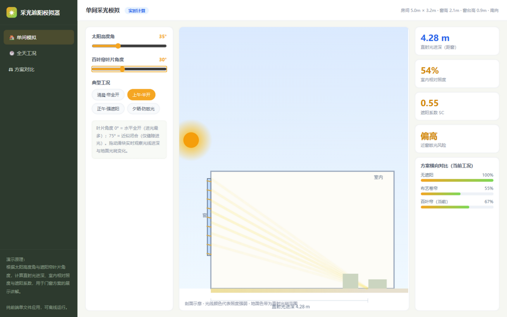
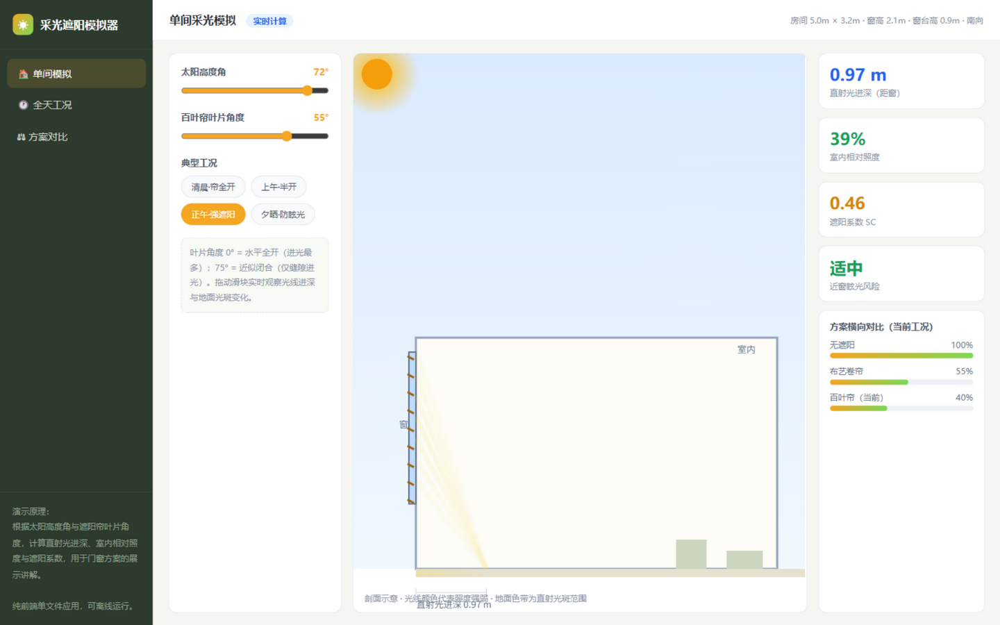
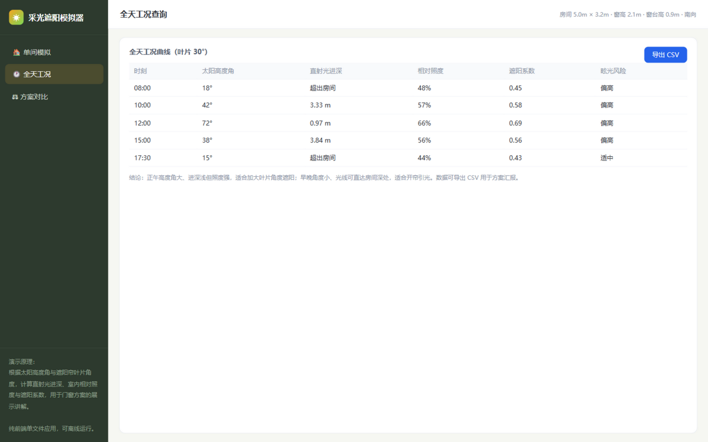

# 建筑遮阳采光模拟演示系统 / Daylight Simulation

交互式采光与遮阳演示工具：根据太阳高度角与遮阳帘叶片角度，实时计算并可视化直射光进深、室内相对照度、遮阳系数与眩光风险。适用于门窗方案讲解、展厅演示与教学场景。

**在线使用**：开启 GitHub Pages 后直接访问仓库 Pages 地址，或双击 `index.html` 离线运行。

## 演示截图

**单间模拟** — 太阳高度角 × 叶片角度实时联动，Canvas 剖面光线动画：

**正午·强遮阳工况** — 高角度太阳 + 大叶片角度，进深缩短、照度下降：

**全天工况** — 分时段数据对照，支持一键导出 CSV：

## 功能

- **单间模拟**：拖动滑块调节太阳高度角（12°–80°）与百叶帘叶片角度（0°–75°），Canvas 剖面光线动画、地面光斑与数据面板实时联动
- **典型工况一键切换**：清晨·帘全开 / 上午·半开 / 正午·强遮阳 / 夕晒·防眩光
- **全天工况**：8:00–17:30 各时刻的进深、照度、遮阳系数对照表，支持一键导出 CSV
- **方案对比**：无遮阳 / 布艺卷帘 / 百叶帘可调三种方案的遮阳系数、采光折减与适用场景对比
- 支持 URL 参数直达工况，如 `index.html?view=main&sun=72&blade=55`

## 物理模型

- 直射光进深：`d = (窗台高 + 窗高) / tan(太阳高度角)`，超出房间深度时截断
- 叶片透光率：随叶片角度线性衰减（0° 全开 → 75° 近似闭合，仅缝隙进光）
- 相对照度、遮阳系数（SC）与眩光风险由透光率与太阳高度角组合计算，用于方案间的相对比较

## 技术栈

纯前端单文件应用：HTML5 + CSS3 + 原生 JavaScript（Canvas 2D 绘图），**零依赖、零构建**，可离线运行，可直接嵌入官网或用平板现场演示。

## 说明

页面内数据为演示用简化模型，计算结果用于方案间的相对比较与展示讲解，不替代专业采光仿真软件。
